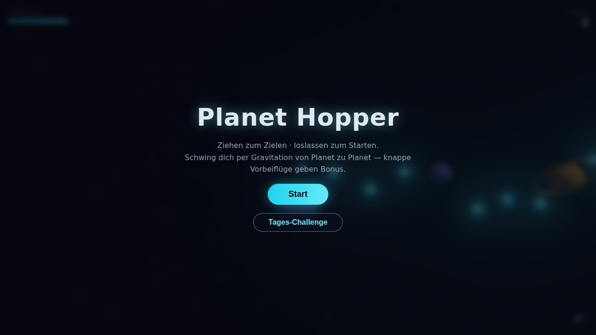
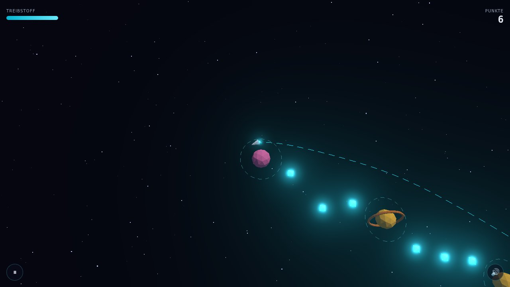
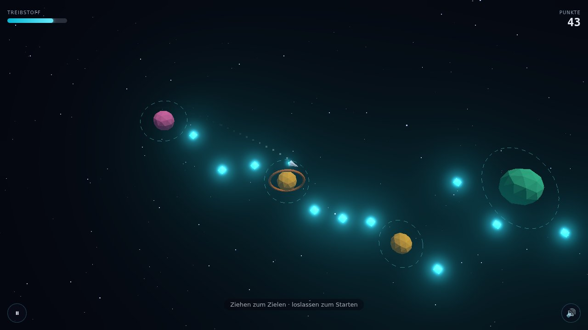

# planet-hopper

Slingshot a ship from planet to planet through an endless, procedurally generated
star field — a 3D browser arcade game built with Three.js + TypeScript. Portfolio
showpiece: custom gravity physics, a deterministic pure-TypeScript core, ghost
replays and a daily challenge without any backend. Target: 60 fps on integrated
GPUs — **not yet verified on real hardware** (see verification table).





<sub>Screenshots: production build in headless Chromium with SwiftShader (software
WebGL), 1280×720, 2026-09-27. Real captures, but not a statement about GPU looks or speed.</sub>

## Status
v1.1 "ghost & shine" (2026-09-27): full arcade loop, ghost replay,
daily challenge + share links, milestone toasts, deeper synth audio. 144 tests green,
typecheck + lint clean, production build without warnings. For the first time the
game was actually **rendered and played headless** (SwiftShader + real mouse input);
that run found and fixed four runtime bugs (stale preview, free flyby per launch, a
sim freeze introduced mid-round, a dev fps overlay that could not measure GPU-bound
frames). Still pending: a human on a real GPU — see "Needs Nico".

> **Open decision — theme A–D.** `npm run dev`, then `http://localhost:5173/?variant=A`
> (or `B`, `C`, `D`; arrows at the bottom switch). The four looks are a dev-only
> prototype (`src/render/theme-prototype.ts`, tree-shaken out of production builds).
> Orientation grid (SwiftShader, not a GPU verdict): `docs/screenshots/theme-variants.jpg`.
> After the pick: fold the winner into `meshes.ts`/`scene.ts`, delete the prototype and
> both `THEME PROTOTYPE HOOK` blocks.

## How to play
- **Aim:** press on the game and drag *away* from where you want to fly (slingshot);
  the dashed line is the real future path — same integrator as the flight.
- **Launch:** release. Gravity does the rest; you are captured by the next planet you
  get close enough to (dashed ring). No mid-flight thrust.
- **Fuel:** every launch costs fuel (stronger = more); crystals refill it. Out of fuel
  in orbit = stranded.
- **Score:** distance + crystals; a close **flyby** past a planet (outside its capture
  ring, without being captured) raises the multiplier for 8 s.
- **Hazards:** suns burn, the void (far from every planet) ends the run after a countdown.
- **Pause:** Esc or the ⏸ button (touch). Mute: 🔊 bottom right (remembered).
- Mouse and touch use the same Pointer Events path.

## Modes
- **Start** — endless run on a fresh random world.
- **Tages-Challenge** — today's world (seed = UTC date `YYYY-MM-DD`), the same for
  everyone; own daily best, separate from the endless record.
- **Seed links** — `?seed=<1–32 chars of A–Z a–z 0–9 _ ->` plays that world; invalid
  values fall back to a random world. After a seeded run, **Teilen** copies
  `Planet Hopper Tages-Challenge 2026-07-21: 4.320 Punkte — schaffst du mehr? <link>`
  (Clipboard API; if blocked, the text is shown pre-selected).
- **Ghost** — replaying a seed shows your best run on it as a translucent ship
  (visual only). Toggle in the pause menu ("Geist: an/aus", remembered). Endless runs
  get no ghost: a random world is never replayed. Runs with more than 50 launches keep
  their score but store no ghost.
- **Milestones** — once per run: first flyby, ×3 multiplier, 1.000 / 5.000 / 10.000
  points, 5 crystals. Non-blocking toast, no meta-progression.

## Verification (what is proven by what)
| Feature | Unit tests (Vitest) | Headless run (SwiftShader, real input) | Real GPU / human |
|---|---|---|---|
| Gravity, integrator, capture | golden test: top-k selection bit-identical to the old copy+sort | — | — |
| Preview = flight | ship flies the previewed samples bit-for-bit; preview follows the orbiting ship | dashed line starts at the ship while holding still | pending (feel) |
| Solvable world | 2000/2000 gaps reachable (50 seeds × 40 gaps); guard flags a void gap | — | — |
| Full loop aim → launch → capture → score → restart | session integration (drain once, pause, capture, death → game over) | bot¹: 10/10 hops captured with real mouse drags, 0 console errors | **pending: game feel** |
| Daily challenge, seed links, share | seed round-trip, UTC date determinism, share text, no network calls in `src/` | daily → game over → Teilen → clipboard text; `?seed=abc`; invalid seed → Start | — |
| Ghost replay | same seed + inputs ⇒ identical per-tick position hashes (also after JSON round-trip); corrupt/old data ⇒ no ghost | ghost visible in the 2nd daily run, pause toggle works | **pending: readability** (opacity 0.35) |
| Milestone toasts | once per run, ≤ 1 per check, reset on restart | "1.000 Punkte!", "5 Kristalle in einem Lauf!" shown in the bot¹ run | **pending: readability** |
| Audio | mute silences everything incl. pad; pad ≤ −24 dB vs. effects; Doppler math | no AudioContext before the first click, `running` after Start, 0 errors (headless is muted — nothing heard) | **pending: mix by ear** |
| Rendering (starfield, bloom, trail, rings) | — | non-blank canvas, 0 console errors, screenshots above | **pending: looks + fps** |
| Dev fps overlay | fps from frame intervals, not CPU time | agrees with an independent rAF measurement (89.4 vs 88.9 ms/frame) | **pending: the real number** |
| Touch / mobile viewport | — | — | **pending** |
| WebGL-less fallback message | — | — (SwiftShader provides WebGL) | **pending** |
| Theme A–D | — | orientation grid | **pending: decision** |

¹ The bot ran on a scratch build of the same commit with one extra line exposing the
session read-only (to know where the next planet is); its input went through real
mouse events. All other headless checks used the unmodified production build.

## Performance (measured, honest)
- **Bundle** (gzip, `npm run build` 2026-09-27): app 11.43 kB + three-core 50.92 kB +
  three 87.52 kB = 149.87 kB JS, + 1.12 kB CSS. Before this round: one 570 kB chunk
  (145.40 kB gzip JS, 0.95 kB CSS) with a size warning. The vendor split costs ~1.2 kB gzip in cross-chunk bindings and
  means a redeploy only invalidates the small app chunk; the app itself grew 2.6 kB
  (ghost, daily, toasts, audio).
- **Frame time, software-rendered only:** 6–10 fps (≈100–165 ms/frame) at 1280×720 in
  headless Chromium + SwiftShader, 3 runs. The CPU profile shows the page's main thread
  ~97 % idle — game logic + preview cost ≈ 0.1–0.3 ms/frame; the frame time is the
  software rasterizer. **This says nothing about GPU performance.** 60 fps on an
  integrated GPU is the target and unverified until measured with the dev overlay
  (`npm run dev`, bottom-left readout) on real hardware.
- Hot path: gravity top-k selection without sort/allocation (5.8× faster than before in
  a node micro-bench: 360 calls 0.184 → 0.032 ms).

## Quickstart
```bash
npm install
npm run dev        # dev server → http://localhost:5173/ (dev fps overlay, ?variant=A–D)
npm run gate       # typecheck + tests + lint (the objective done-check)
npm run build      # production build → dist/
npm run preview    # serve dist/ → http://localhost:4173/
```

## Deploy (prepared, not published)
`.github/workflows/deploy.yml` builds and deploys to GitHub Pages on every push to
`main` (gate first). The relative base (`./`) works for project pages without knowing
the repo name; `BASE_PATH=/name/ npm run build` forces an absolute base if a host needs
it. Action pins were bumped to the Node 24 majors on 2026-09-27; the workflow has never
run — the first push to a real remote is its test. No remote exists yet (Nico's call).

## Audio mix
All sound is synthesized at runtime (WebAudio) — no audio files. The final mix is by ear:
three linear gains in `src/audio/mix.ts` — `SFX_GAIN` (all one-shot effects), `PAD_GAIN`
(ambient pad, 0.012 ≈ −24 dB below the loudest effect), `DEATH_NOISE_GAIN` (noise layer
of the death sound). Halving a value ≈ −6 dB.

## Architecture
Pure logic (`src/core`, `src/physics`, `src/world`) has no Three.js/DOM imports and is
unit-tested headless. `core/run-driver` is one seeded, fixed-timestep run (the live game
and the ghost are two instances); `core/session` wires input → sim and drains events once
per frame; `core/run-lifecycle` is the registry every per-run subsystem must be reset
through. `src/render`, `src/ui`, `src/audio` consume that state; `src/main.ts` is glue.

## Stack
Three.js · TypeScript · Vite · Vitest · ESLint. UI is a plain DOM overlay; audio is
synthesized via WebAudio. No UI framework, no runtime network access.

## License
MIT — see `LICENSE`.
